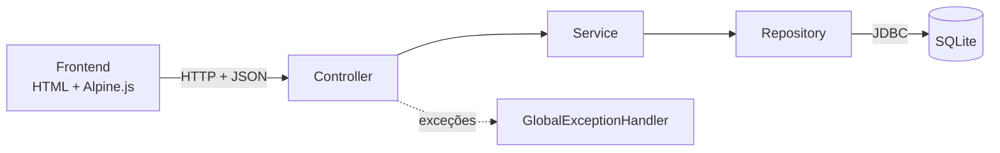

# Controle de Despesas

Aplicação pessoal, sem autenticação, para registrar e acompanhar despesas mensais. Roda localmente e guarda os dados em um arquivo SQLite no diretório do usuário.

Versão atual: 1.0.0.

## Funcionalidades

- Cadastrar despesas com descrição (até 200 caracteres), valor em reais e data.
- Listar as despesas da data mais recente para a mais antiga.
- Editar e excluir despesas, com confirmação antes de excluir.
- Filtrar a listagem por mês e ano.
- Exibir o total do mês filtrado ou, sem filtro, o total de todas as despesas.
- Exibir valores como `R$ 1.234,56` e datas como `dd/MM/yyyy`.

Fora do escopo: receitas, orçamento, gráficos, login, importação de extrato e recursos de IA.

## Stack

| Camada | Tecnologia |
|---|---|
| Linguagem | Java 21 |
| Framework | Spring Boot 3 (Web e Data JPA) |
| Build | Maven, com Maven Wrapper |
| Banco | SQLite (`sqlite-jdbc` e `hibernate-community-dialects`) |
| Frontend | HTML e Alpine.js, servidos como recursos estáticos, sem CDN |
| Testes | JUnit 5, Mockito, MockMvc e `TestRestTemplate` |

## Instalação

Pré-requisitos:

- JDK 21
- Git
- Acesso à internet na primeira execução, para o wrapper baixar o Maven e as dependências

Não é necessário instalar o Maven.

```bash
git clone https://github.com/leonardo-rp-dev/controle-despesas.git
cd controle-despesas
```

O repositório versiona o `mvnw` com permissão de execução. No Linux e no macOS, se o sistema de arquivos perder essa permissão, restaure-a com `chmod +x mvnw` ou rode o wrapper com `sh mvnw`.

## Execução

Linux e macOS:

```bash
./mvnw spring-boot:run
```

Windows (PowerShell):

```powershell
.\mvnw spring-boot:run
```

Com a aplicação no ar:

- Interface: http://localhost:8080
- Health check: http://localhost:8080/health

Resposta esperada de `GET /health`:

```json
{"status": "ok", "timestamp": "2026-01-01T12:00:00-03:00"}
```

### Gerar e executar o jar

```bash
./mvnw clean package
java -jar target/controle-despesas-1.0.0.jar
```

Para usar outra porta: `java -jar target/controle-despesas-1.0.0.jar --server.port=9090`.

### Banco de dados

O banco fica em `~/.despesas/despesas.db`. O diretório e o arquivo são criados na primeira execução.

Para zerar os dados, encerre a aplicação e remova o arquivo:

```bash
rm ~/.despesas/despesas.db
```

```powershell
Remove-Item "$HOME\.despesas\despesas.db"
```

### Erro de certificado (PKIX) no Windows

Em redes com inspeção TLS, o Maven pode falhar com `PKIX path building failed`. Use o repositório de certificados do Windows:

```powershell
$env:MAVEN_OPTS = "-Djavax.net.ssl.trustStoreType=Windows-ROOT"
.\mvnw spring-boot:run
```

## Uso com Make

O `Makefile` é um atalho para os comandos do wrapper. Usa `mvnw.cmd` quando a variável `OS` é `Windows_NT` e `./mvnw` nos demais sistemas.

| Comando | O que faz |
|---|---|
| `make install` | Baixa as dependências e compila, sem rodar os testes (`clean package -DskipTests`) |
| `make run` | Inicia a aplicação (`spring-boot:run`) em http://localhost:8080 |
| `make test` | Executa todos os testes (`verify`) |

`make` sem argumentos lista os comandos. Se o Maven falhar, o Makefile lembra de conferir o JDK 21 e o `JAVA_HOME`.

O Make não vem instalado no Windows, nem no Git Bash. Instale-o à parte ou use direto os comandos da seção Execução.

## Testes

```bash
./mvnw verify
```

Resultado da última execução: 121 testes, 0 falhas. Nenhum teste usa `~/.despesas`: os que precisam de banco usam um SQLite em arquivo temporário.

| Grupo | Testes | O que cobre |
|---|---|---|
| `DespesaServiceTest` | 63 | Regras de negócio com o repositório mockado: validações, conversão em centavos, filtro por mês, totais |
| `DespesaControllerTest` | 27 | Rotas, status, corpo JSON e erros, com o service mockado |
| `HealthControllerTest` | 3 | `/health` e erros da rota |
| `DespesaRotasClienteTest` | 9 | Rotas por um cliente HTTP real (201, 200, 204 e 404), com o repositório mockado |
| `DespesaRepositoryTest` | 7 | Consultas por período e somas contra SQLite real |
| `FluxoCompletoTest` | 6 | Fluxos ponta a ponta: cadastrar, filtrar, editar, excluir e conferir totais |
| `GlobalExceptionHandlerTest` | 4 | Ramos raros do tratamento de erros |
| `DesempenhoListagemTest` | 2 | Listagem e total de um mês com 1.000 despesas em até 500 ms |

### Cobertura

O projeto não configura o JaCoCo no `pom.xml`. Para medir sem alterá-lo:

```bash
./mvnw -B org.jacoco:jacoco-maven-plugin:0.8.12:prepare-agent verify org.jacoco:jacoco-maven-plugin:0.8.12:report
```

O relatório fica em `target/site/jacoco/index.html`.

Medição de 2026-10-16:

| Métrica | Cobertura |
|---|---|
| Linhas | 97,6% (121 de 124) |
| Branches | 100% (30 de 30) |
| Métodos | 98,1% (53 de 54) |

As 3 linhas sem cobertura estão no `main` de `DespesasApplication`, que cria o diretório `~/.despesas` e inicia o Spring. A interface web (`app.js` e `index.html`) não tem teste automatizado.

## Arquitetura

Monólito em um único processo. O navegador acessa a aplicação em `localhost:8080`, e a aplicação lê e grava o arquivo SQLite no diretório do usuário.



Diagramas completos (componentes, fluxo de dados, sequência, modelo de dados e implantação) em [docs/diagramas.md](docs/diagramas.md).

| Camada | Pacote | Responsabilidade |
|---|---|---|
| Controller | `controller` | Recebe a requisição e delega ao service |
| Service | `service` | Regras de negócio, validações e conversão de valores |
| Repository | `repository` | Acesso a dados com Spring Data JPA |
| Model | `model` | Entidade `Despesa` |
| DTO | `dto` | Objetos de entrada e saída da API |
| Exception | `exception` | Exceções e formato único de erro |

### Fluxo de uma requisição

1. O frontend envia a requisição em JSON ao controller.
2. O controller entrega o DTO ao service, sem regra de negócio.
3. O service valida, converte reais em centavos e chama o repository.
4. O repository lê ou grava no SQLite.
5. O service converte centavos em reais e devolve o DTO de saída.
6. Qualquer erro vira uma resposta `{status, mensagem, timestamp}` pelo `GlobalExceptionHandler`.

### Modelo de dados

Tabela `despesa`:

| Coluna | Tipo | Observação |
|---|---|---|
| `id` | inteiro | Chave primária, gerada pelo banco |
| `descricao` | texto | Até 200 caracteres |
| `valor_centavos` | inteiro | Valor em centavos, sem ponto flutuante |
| `data` | data | Gravada como `AAAA-MM-DD` |

A API recebe e devolve o valor em reais com duas casas (`12.34`). O banco guarda `1234`.

## API

| Método | Rota | Descrição |
|---|---|---|
| POST | `/api/despesas` | Cadastra uma despesa |
| GET | `/api/despesas?mes=yyyy-MM` | Lista as despesas, com filtro opcional por mês |
| GET | `/api/despesas/total?mes=yyyy-MM` | Total das despesas, com filtro opcional por mês |
| PUT | `/api/despesas/{id}` | Edita uma despesa |
| DELETE | `/api/despesas/{id}` | Exclui uma despesa |
| GET | `/health` | Verifica se a aplicação está no ar |

Exemplo de cadastro:

```bash
curl -X POST http://localhost:8080/api/despesas \
  -H "Content-Type: application/json" \
  -d '{"descricao":"Mercado","valor":12.34,"data":"2026-10-10"}'
```

```json
{"id":1,"descricao":"Mercado","valor":12.34,"data":"2026-10-10"}
```

Parâmetros, respostas e a tabela completa de erros em [docs/api.md](docs/api.md).

## Estrutura de pastas

```text
controle-despesas/
├── docs/                       escopo, backlog, diagramas e API
├── prompts/                    prompts usados na geração do projeto
├── src/
│   ├── main/
│   │   ├── java/br/com/despesas/
│   │   │   ├── controller/     DespesaController, HealthController
│   │   │   ├── service/        DespesaService, PeriodoMes
│   │   │   ├── repository/     DespesaRepository
│   │   │   ├── model/          Despesa
│   │   │   ├── dto/            requisições e respostas
│   │   │   └── exception/      exceções e GlobalExceptionHandler
│   │   └── resources/
│   │       ├── application.properties
│   │       └── static/         index.html, css/, js/ (Alpine.js local)
│   └── test/java/br/com/despesas/
├── mvnw, mvnw.cmd, .mvn/       Maven Wrapper
└── pom.xml
```

## Limitações

- Uso local por uma única pessoa: não há autenticação, usuários nem controle de acesso.
- Os dados ficam em um arquivo SQLite no diretório do usuário, sem sincronização nem backup.
- Só há moeda em reais (BRL): a API não tem campo de moeda.
- O valor máximo aceito é `92233720368547758.07`, o que cabe em centavos num `long`.
- A listagem devolve todas as despesas do filtro, sem paginação. O desempenho foi medido até 1.000 despesas em um mês.
- Os erros 404 de rota, 405 e 415 retornam a mensagem genérica "Requisição inválida". O status HTTP indica a causa.
- A interface web não tem teste automatizado. O comportamento da tela (formatação, layout a partir de 360 px, mensagens de erro) depende de verificação manual no navegador.
- A execução foi verificada apenas no Windows. Linux e macOS não foram testados.
- O `main` da aplicação, que cria `~/.despesas`, não é coberto por teste automatizado.
- O `Makefile` ainda não foi executado com o Make: só os comandos que ele roda foram validados.

## Próximos passos

Propostas, ainda não implementadas:

- Integração contínua com GitHub Actions rodando `./mvnw verify` a cada push e pull request.
- Configurar o JaCoCo no `pom.xml` para gerar o relatório no build, com meta mínima de cobertura.
- Testes automatizados da interface (por exemplo, com Playwright).
- Mensagens específicas para os erros 404 de rota, 405 e 415.
- Paginação da listagem.
- Exportação dos dados (por exemplo, CSV).

## Documentação adicional

- [docs/escopo-mvp.md](docs/escopo-mvp.md): requisitos funcionais e não funcionais do MVP.
- [docs/backlog.md](docs/backlog.md): releases e backlog, com critérios de aceite.
- [docs/diagramas.md](docs/diagramas.md): diagramas de arquitetura.
- [docs/api.md](docs/api.md): documentação da API.
- [prompts/](prompts/): prompts usados na geração do projeto.

## Roadmap

| Release | Escopo | Situação |
|---|---|---|
| v0.1.0 | Estrutura do projeto e endpoint `/health` | Concluída |
| v0.2.0 | Cadastro e listagem de despesas | Concluída |
| v0.3.0 | Edição e exclusão de despesas | Concluída |
| v0.4.0 | Filtro por mês e total do período | Concluída |
| v1.0.0 | Testes e documentação | Concluída |
