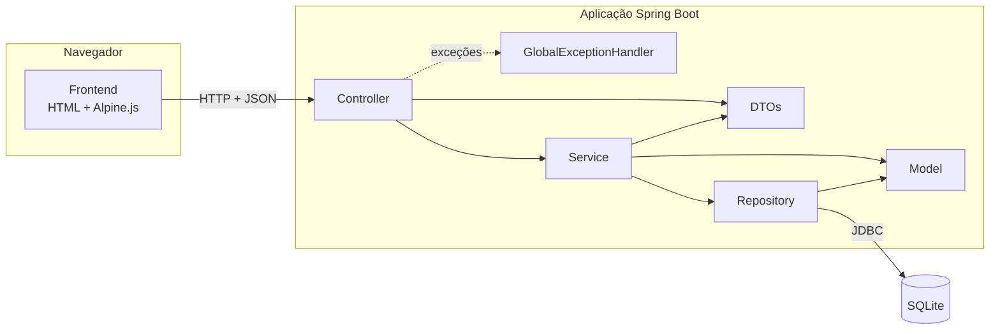
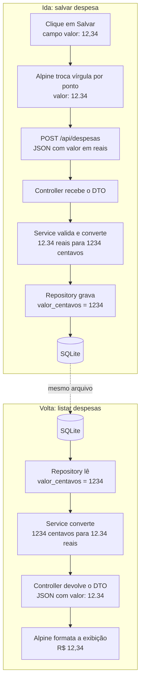
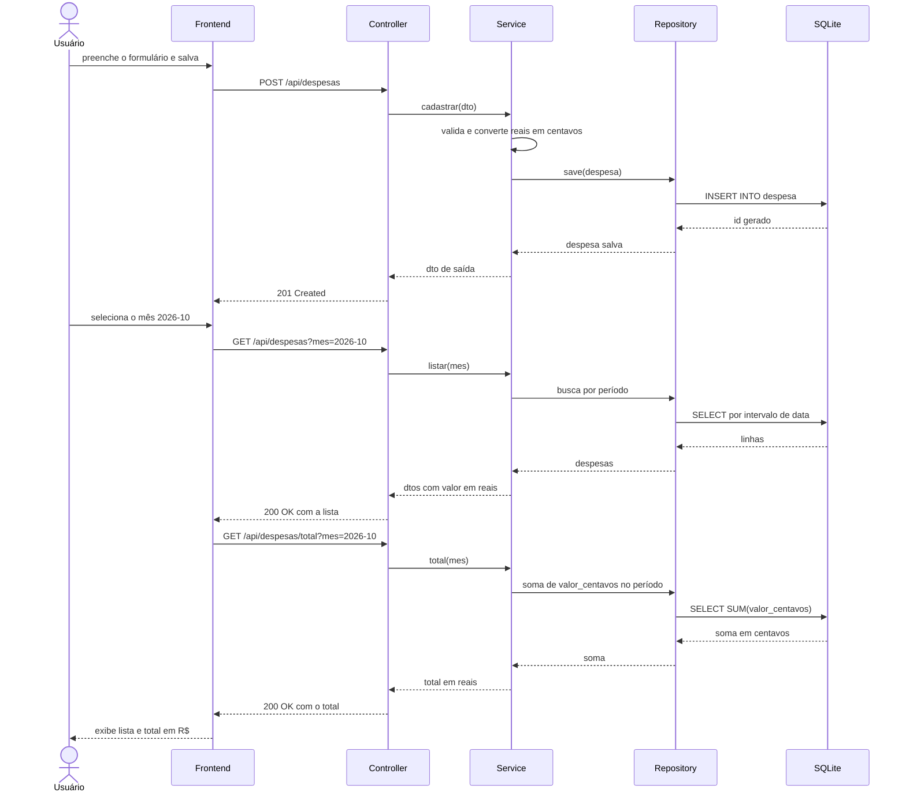
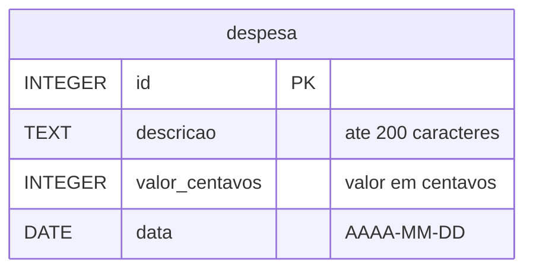
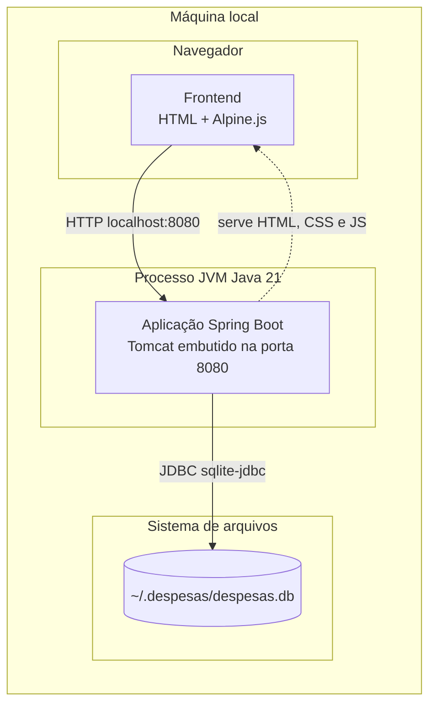

# Diagramas

Os diagramas usam Mermaid e são renderizados pelo GitHub.

## 1. Componentes

Camadas da aplicação e suas dependências: o controller usa DTOs e delega ao service, que acessa o banco pelo repository.

## 2. Fluxo de dados

Caminho do clique no navegador até o SQLite e a volta, com as conversões de vírgula para ponto e de reais para centavos.

## 3. Sequência

Cadastro de uma despesa seguido da listagem do mês com o total.

## 4. Modelo de dados

Tabela `despesa`, com o valor guardado em centavos inteiros.

## 5. Implantação

Tudo roda na máquina local: o navegador acessa a aplicação em um único processo Java, que lê e grava o arquivo do banco no diretório do usuário.

